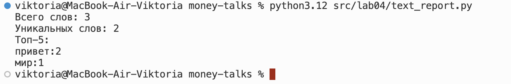
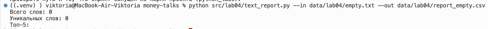

# Лабораторная работа №4
## Задание 1
### read_text
```python
def read_text(path: str | Path, encoding: str = "utf-8") -> str:

    return Path(path).read_text(encoding=encoding)

```
### write_csv
```python
def write_csv(
    rows: list[tuple | list],
    path: str | Path,
    header: tuple[str, ...] | None = None,
) -> None:
    rows = [list(row) for row in rows]
    if rows:
        width = len(rows[0])
        for number, row in enumerate(rows, start=1):
            if len(row) != width:
                raise ValueError(
                    f"строка {number} имеет длину {len(row)}, "
                    f"а первая строка — {width}"
                )
                with Path(path).open("w", newline="", encoding="utf-8") as f:
        
        writer = csv.writer(f)
        if header is not None:
            writer.writerow(header)
        writer.writerows(rows)

```
## Задание 2
### Скрипт читает файл, лежащий в data, нормализует текст из этого файла, токенизирует и считает частоты слов, после чего сохраняет report.csv с колонками word, count, а в консоль печатает краткое резюме. Если файл не найден или указана неверная кодировка, то через цикл except 'ловим' ошибку и принтим ее, после чего выходим из цикла try-except.

```python
import argparse
import sys
from pathlib import Path

# добавляем папку src/ в пути поиска модулей, чтобы работал импорт lib.text
# при запуске скрипта из любой директории
SRC_DIR = Path(__file__).resolve().parent.parent
sys.path.append(str(SRC_DIR))


from lib.text import normalize, tokenize, count_freq, top_n
from io_txt_csv import read_text, write_csv, ensure_parent_dir

DEFAULT_INPUT = "data/lab04/input.txt"
DEFAULT_OUTPUT = "data/lab04/report.csv"


def parse_args() -> argparse.Namespace:
    """Разобрать аргументы командной строки."""
    parser = argparse.ArgumentParser(
        description="Считает частоты слов в текстовом файле и сохраняет отчёт в CSV."
    )
    # dest="inp", потому что args.in — синтаксическая ошибка: in ключевое слово
    parser.add_argument(
        "--in",
        dest="inp",
        default=DEFAULT_INPUT,
        help=f"путь к входному текстовому файлу (по умолчанию {DEFAULT_INPUT})",
    )
    parser.add_argument(
        "--out",
        dest="out",
        default=DEFAULT_OUTPUT,
        help=f"путь к создаваемому CSV-отчёту (по умолчанию {DEFAULT_OUTPUT})",
    )
    parser.add_argument(
        "--encoding",
        default="utf-8",
        help="кодировка входного файла (по умолчанию utf-8), например cp1251",
    )
    return parser.parse_args()


def load_text(path: str, encoding: str) -> str:
    """Прочитать входной файл, а при ошибке завершить работу с пояснением.

    Сам `read_text` ошибки не перехватывает — это делает скрипт,
    чтобы пользователь увидел понятное сообщение вместо трассировки.
    """
    try:
        return read_text(path, encoding=encoding)
    except FileNotFoundError:
        print(f"Файл не найден: {path}", file=sys.stderr)
        print(
            "Проверьте путь и то, что скрипт запущен из корня проекта (python_labs).",
            file=sys.stderr,
        )
        sys.exit(1)
    except UnicodeDecodeError:
        print(
            f"Файл {path} не читается в кодировке {encoding}",
            file=sys.stderr,
        )
        print("Укажите подходящую, например: --encoding cp1251", file=sys.stderr)
        sys.exit(1)


def main() -> None:
    args = parse_args()

    raw_text = load_text(args.inp, args.encoding)

    tokens = tokenize(normalize(raw_text))
    freq = count_freq(tokens)

    # top_n сортирует по count вниз, при равенстве по слову вверх тот
    # порядок, что требует задание. берём len(freq), то есть вообще все слова
    all_counts = top_n(freq, len(freq))

    ensure_parent_dir(args.out)
    write_csv(all_counts, args.out, header=("word", "count"))

    print(f"Всего слов: {len(tokens)}")
    print(f"Уникальных слов: {len(freq)}")
    print("Топ-5:")
    for word, count in top_n(freq, 5):
        print(f"{word}:{count}")


if __name__ == "__main__":
    main()
```



## Краевые случаи
### data/input.txt не существует - цикл try/except поймает ошибку и выведет ее в консоли

### При пустом входе report.csv будет содержать только заголовок

### При нестандартной кодировке необходимо указать в терминале --encode ... (где ... тип кодировки, пример у тест-кейса с кодировкой cp1251)
