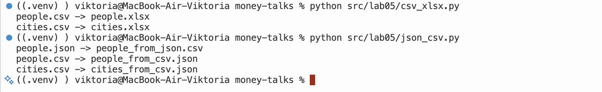
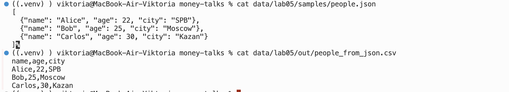
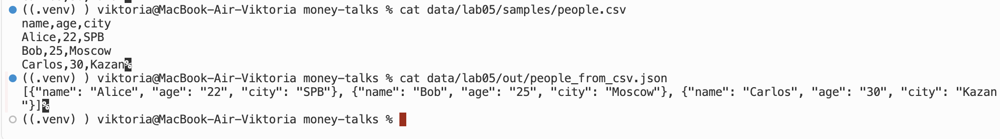
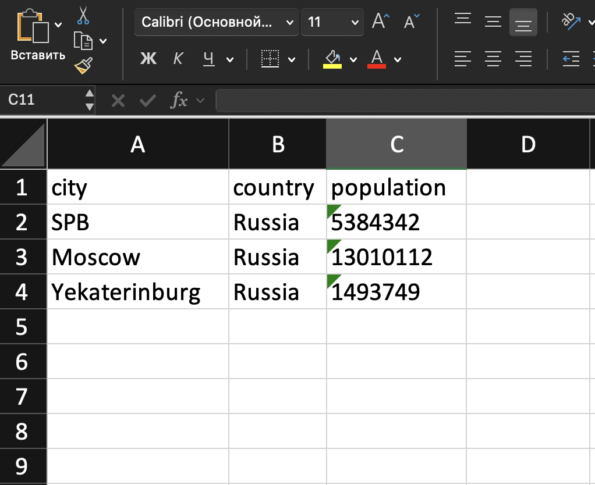

# Лабораторная работа №5
## Задание 1

### json_to_csv
```python
from pathlib import Path
import sys
import json
import csv

def json_to_csv(json_path: str, csv_path: str) -> None:
    json_file = Path(json_path)
    csv_file = Path(csv_path)

    if not(json_file.exists()): raise FileNotFoundError('Пустой файл или неверный путь/не существует')
    if json_file.suffix.lower() != '.json': raise ValueError('Неверный тип файла')
    if csv_file.suffix.lower() != '.csv': raise ValueError('Неверный тип файла')

    with open(json_file, "r", encoding="utf-8") as file:
            try:
                json_list = json.load(file)
            except json.JSONDecodeError:
                 print('Пустой файл или ошибка чтения(неверный формат)')
                 sys.exit(1)
    if json_list is None: raise FileNotFoundError('Пустой файл')
    if not isinstance(json_list,list): raise ValueError('Неверный тип данных')
    if not all(isinstance(list_item,dict) for list_item in json_list): raise ValueError('Неверный тип данных')

    fieldnames = dict()
    for i in json_list:
         for key in i.keys():
              fieldnames[key] = None

    with open(csv_file, 'w', newline = '', encoding = 'utf-8') as file:
         w = csv.DictWriter(file, fieldnames = fieldnames)
         w.writeheader()
         w.writerows(json_list)
```

### csv_to_json
```python
def csv_to_json(csv_path: str, json_path: str) -> None:
    json_file = Path(json_path)
    csv_file = Path(csv_path)
    if not(json_file.exists()): raise FileNotFoundError('Пустой файл или неверный путь/не существует')
    if json_file.suffix.lower() != '.json': raise ValueError('Неверный тип файла')
    if  csv_file.suffix.lower() != '.csv': raise ValueError('Неверный тип файла')

    with open(csv_file, 'r', newline = '', encoding = 'utf-8') as file:
        DReader = csv.DictReader(file)
        if DReader.fieldnames == None: raise ValueError('Пустой заголовок')
        csv_list = list(DReader)

    if csv_list is None: raise ValueError('Пустой файл')
    with open(json_file, "w", encoding = "utf-8") as file:
        json.dump(csv_list, file, ensure_ascii = False, indent = 2)
```

## Задание 2
### csv_to_xlsx
```python
import csv
from pathlib import Path
from openpyxl import Workbook

def csv_to_xlsx(csv_path: str, xlsx_path: str) -> None:
    csv_file = Path(csv_path)
    xlsx_file = Path(xlsx_path)
    if not(csv_file.exists()): raise FileNotFoundError('Пустой файл или неверный путь/не существует')
    if csv_file.suffix.lower() != '.csv': raise ValueError('Неверный тип файла')
    if xlsx_file.suffix.lower() != '.xlsx': raise ValueError('Неверный тип файла')

    with open(csv_file, 'r', newline = '', encoding = 'utf-8') as file:
        file_reader = list(csv.reader(file))
    if file_reader is None: raise FileNotFoundError('Пустой файл')
    wb = Workbook()
    ws = wb.active
    ws.title = 'Sheet1'
    for row in file_reader:
        ws.append(row)
    for column in ws.columns:
        mx = 0
        lt = column[0].column_letter
        for item in column:
            if not(item.value is None) and len(str(item.value)) > mx: mx =  len(str(item.value))
        ws.column_dimensions[lt].width = max(mx, 8)
    wb.save(xlsx_file)
```

